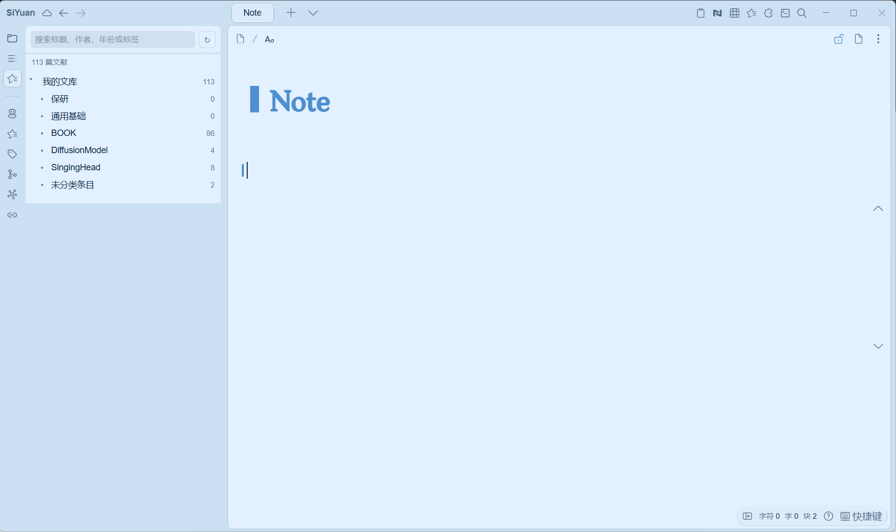

# Zotero Notes for SiYuan

[简体中文](README_zh_CN.md)

A SiYuan desktop plugin for browsing a Zotero 10+ library, creating paper notes on demand, and syncing a SiYuan `Note` document back to the corresponding Zotero item.

> **Internal testing preview**
>
> This plugin is still undergoing internal testing. Back up your SiYuan workspace and Zotero data before use, and avoid using it as the only copy of important notes. Please test first in a non-production workspace. Bug reports, reproduction steps, and feature suggestions are welcome through [GitHub Issues](https://github.com/bnoij/siyuan-plugin-zotero-notes/issues).

## Features

- Imports all personal-library items, nested collections, and attachment indexes automatically.
- Preserves the Zotero collection hierarchy in a searchable SiYuan Dock.
- Filters items by title, author, year, or tag.
- Creates documents only when requested; importing the library does not create documents in bulk.
- Creates a plugin-managed paper document and a writable `Note` child document.
- Generates basic metadata, abstract, tags, and local/Zotero attachment links.
- Refreshes paper metadata without changing `Note`.
- Exports standard Markdown and converts it into a sanitized, editable Zotero rich-text note.
- Shows a rendered sync preview and lists formats that may be lost on upload; later syncs update the same child note, with version preconditions to avoid overwriting conflicting edits.
- Limits the number of authors shown per item, replacing the rest with "et al." to keep long author lists from overflowing.
- Offers separate auto-sync intervals for the library and for note uploads (in minutes, 0 disables), uploading only notes whose content changed.
- Library refreshes are incremental by default: Zotero local versions are compared first, so only changed items are fetched and deletions are detected; a full-sync mode is available in the settings.
- Paper documents carry `custom-zotero-*` attribute markers; bindings and automatic migration are resolved through SiYuan's database using those markers.
- Migrates existing paper notes under a new root document automatically when the notebook or root document name changes, renaming same-title documents with an itemKey suffix.
- Uses SiYuan theme variables for the Dock panel and buttons so it adapts to light, dark, and third-party themes.
- Inserts numeric, author-date, or narrative citations from a multi-item selector and maintains a refreshable bibliography.
- Imports PDF highlights, comments, page numbers, and Zotero deep links into a managed Note annotation section without changing other content.
- Exports GB/T 7714, APA, IEEE, BibTeX/BibLaTeX, Typst, and LaTeX citations, plus Markdown, Word, and LaTeX documents.
- Provides safe initial Note templates with whitelisted metadata and if/range controls, never arbitrary JavaScript evaluation.
- Maps papers to native SiYuan database rows bound by paper document ID without duplicate rows on repeat sync.
- Imports CSL-JSON and BibTeX files, and retrieves metadata from DOI, arXiv, ISBN, PMID/PMCID, and URLs.
- Extracts XMP and limited text streams from local PDFs, showing metadata source and confidence; filenames are only low-confidence fallbacks.
- Uses an existing pdf2zh installation to create mono or dual PDF attachments while preserving originals, with bounded concurrency, per-item cancellation, failure cleanup, and process timeouts.
- Renumbers citations across a document tree, builds a managed `Reference` child document, and assigns cited papers to a stable Connected Documents collection.
- Exposes `ensure_papers`, `write_documents`, `refresh_library`, and `translate_paper` Agent Actions plus bounded eventBus library payloads.

## Requirements

- SiYuan 3.7.0 or later on Windows, macOS, or Linux desktop.
- Zotero 10 or later.
- Zotero must be running during import and synchronization.
- Enable **Allow other applications on this computer to communicate with Zotero** in Zotero **Settings → Advanced**.

Zotero 7, group libraries, mobile frontends, and the Zotero cloud Web API are not currently supported. Better BibTeX and debug-bridge are not required.

## Installation

### Manual installation

1. Download `package.zip` from this repository's [Releases](https://github.com/bnoij/siyuan-plugin-zotero-notes/releases).
2. Extract it into `data/plugins/siyuan-plugin-zotero-notes/` in your SiYuan workspace.
3. Restart SiYuan and enable **Zotero Notes** under **Settings → Marketplace → Downloaded**.

The plugin is not yet listed in the SiYuan bazaar. Marketplace availability will be announced after the testing and release process is complete.

## Usage

1. Open the plugin settings and select a destination notebook.
2. Keep the default root document name `Zotero`, or choose another name (existing notes migrate to the new root automatically).
3. Open the **Zotero Notes** Dock and refresh the library. This imports only the library index.
4. Click **Create note** on an item to create:
   - `Zotero/Paper title`: the plugin-managed metadata document;
   - `Zotero/Paper title/Note`: your writable note document.
5. Write in `Note`, click **Sync Note** in the button row below the item, review the Markdown preview, and confirm; or enable note auto-sync in the settings to upload changed notes automatically at the chosen interval.
6. On the first sync, approve the write request in Zotero. Choose **Always Allow** if you want Zotero to remember the local authorization.

Each item offers **Create/Open note**, **Refresh metadata**, **Sync Note**, **Import PDF annotations**, and **Select in Zotero**. Actions requiring an existing document stay disabled until it exists.

The top-bar plugin menu opens the multi-item citation selector and export dialog. Citation links keep stable itemKeys, bibliographies are formatted by the Zotero Local API, and refreshes update only plugin-marked bibliography blocks. Bibliographies and the PDF annotation section are managed regions rebuilt on refresh; do not write content there that you need to preserve. Exports are static output, not editable Zotero fields in Word; complex custom CSL in-text rules are not guaranteed to be reproduced exactly.

## Synchronization and conversion

Synchronization is **SiYuan `Note` → Zotero child note**, not real-time two-way sync.

SiYuan first exports standard Markdown and then converts it with Lute. Kramdown block attributes and `.sy` JSON are never sent to Zotero. Headings, lists, quotes, code, tables, and links use SiYuan's converter. Scripts, iframes, event handlers, and unsafe URLs are removed before writing.

Local PNG, JPEG, GIF, and WebP images are embedded into the Zotero note. Each image is limited to 5 MiB, with a 20 MiB total per sync. Missing or oversized images are removed and reported in the preview.

Zotero stores native notes as rich-text HTML; Markdown is the interchange format shown in the preview. If the Zotero note changes before a sync, the plugin reports a conflict instead of automatically overwriting it. Removing an item from Zotero never deletes its SiYuan documents.

Write personal content in `Note`; the paper document is maintained by the plugin. Reserved path characters in titles are replaced, and distinct same-title items receive an itemKey suffix.

## Privacy and data safety

Zotero traffic stays on `127.0.0.1:23119`. Settings, the library cache, document bindings, and remembered local write keys use SiYuan's private plugin storage. They are excluded from the release package and are not logged. Uninstalling the plugin does not delete paper documents or Zotero items. Your pdf2zh model provider is configured separately and may receive PDF content; review its privacy policy before translating.

Even with these safeguards, maintain independent backups while the plugin is in internal testing.

## Translation and advanced workflows (0.5.0)

Translation is optional. Install and configure a compatible pdf2zh yourself, then set its executable path, source/target languages, and 1–8 concurrent jobs in the plugin settings. The plugin does not install pdf2zh or deploy a model service. Items with paper notes offer **Translate** with mono or dual output. Translated files are written beside the source PDF and uploaded as new attachments; the original PDF and `Note` are never overwritten, and the same item cannot run twice concurrently.

When a model secret is needed, store it in SiYuan **Settings → Secrets and Variables**, then list only its environment variable name under **Translation secret names** (for example, `OPENAI_API_KEY`; separate names with commas). Only names are persisted in plugin settings. Values are read at runtime with `getSecret` and are never written to settings, logs, or eventBus payloads. Unlisted key/token/secret-like environment variables are not forwarded to the process.

**Cancel this translation** affects only the selected item; unloading the plugin stops scheduling and terminates every active process. Processes time out after 30 minutes, and Agent queue waits time out after 31 minutes. A failed upload deletes the newly created empty attachment with a version precondition; completed outputs are not deleted when another task fails. Automated tests use a stub CLI to verify real process creation, mono/dual outputs, nonzero exits, cancellation, and recovery. They do not establish that a particular pdf2zh release or translation model has passed real-engine validation.

The top-bar **Connected citations** action uses the active top-level document as its root, orders documents by path, renumbers their citations, and rebuilds a managed `Reference` child document. Do not write manual content in that document or its bibliography. The action then synchronizes `【【Connected Documents】】→ rootDocumentID`, adding only missing memberships and preserving all other collections. Missing Zotero keys are reported explicitly, and a database-version change triggers one refresh and retry.

Agent Actions are `ensure_papers`, `write_documents`, `refresh_library`, and `translate_paper`. Document conflict policies are `report` and `overwrite`; translation failures return the job error. The eventBus `GetFromPool` event returns at most 200 compact items and reports the full count separately as `total`; `Refresh` triggers a library refresh. Translation tasks and event listeners are cleaned up on unload.

## Templates, database, and import enhancements (0.4.0)

The **initial Note template** setting applies only to newly created Notes. Supported fields are `title`, `authors`, `year`, `journal`, `DOI`, `abstract`, `tags`, `noteLink`, and `itemKey`, plus `if`/`range` controls. Property chains and JavaScript evaluation are not supported. Existing Notes are never overwritten by template or metadata refreshes.

The top-bar **Paper database** action creates or opens a native database and synchronizes existing paper documents. Rows bind title, authors, year, journal, DOI, tags, and URL by paper document ID; repeat sync updates rather than duplicates or deletes rows.

**Import papers** accepts CSL-JSON and BibTeX files. **Retrieve / PDF import** accepts DOI, arXiv, ISBN, PMID/PMCID, URLs, and local PDFs. Results are previewed and editable before creation. Duplicates are skipped by default; selecting **Create duplicate** creates a real new item. Per-entry failures are reported without blocking valid imports.

PDF recognition uses XMP first, limited text streams second, and filenames only as low-confidence fallbacks. Review low-confidence results manually. Image-only PDFs do not receive OCR. arXiv DOIs missing from Crossref fall back to the arXiv Atom API. External metadata requests time out after 15 seconds.

## Kimi research workflow import (0.2.0)

The plugin exposes two generic operations: `ensure_papers` ensures that Zotero items, paper documents, `Note` documents, and bindings exist; `write_documents` writes caller-provided Markdown unchanged. Kimi Work remains responsible for recommendations, candidate deduplication, report/analysis content, and conflict policy. The plugin does not generate daily reports or overwrite conflicts on its own.

Kimi Work submits jobs through `/api/file/putFile` under `data/storage/petal/siyuan-plugin-zotero-notes/jobs/pending/`. The plugin claims jobs every 2 seconds and writes results through `processing/` into `completed/` or `failed/`. Disable **Kimi research import queue** in the settings to turn off this channel. Job files never contain the Zotero write key.

`write_documents` checks `expectedHash` before writing. A changed document returns `conflict` unless the caller explicitly sets `onConflict: "overwrite"`. `custom-research-content-hash` stores the normalized hash after import. The existing `custom-zotero-server-id`, `custom-zotero-item-key`, `custom-zotero-note-doc-id`, and `custom-zotero-note-key` attributes remain the source of truth for item binding and Note synchronization.

Background imports reuse `createOrOpenExclusive({openTab:false})`, producing the same `Zotero/Paper title/Note` structure as manual creation. AI analysis written into `Note` can therefore use the existing preview, sync, and auto-sync features.

Every `ensure_papers` run first ensures that the personal library has a `daily` collection, creating it when absent. New items are assigned immediately; existing items missing the collection are updated with PATCH without duplication or removing their other collections.

## Development

The plugin is directly loadable CommonJS with no npm dependencies and no build step. Runtime files are located at the repository root.

A release archive contains `plugin.json`, `index.js`, `index.css`, `i18n/`, both README files, `icon.png`, `preview.png`, and `LICENSE` at its root.

### Automated checks

With Node.js 22 or later, run `npm test` for lifecycle and multi-window regressions, or `npm run check` for both syntax and tests. The tests cover startup persistence, unchanged-cache writes, `onDataChanged`, background imports, cross-window binding merges, and origin-wide document-creation locks. Development-only test files are excluded from `package.zip`.

## Feedback

Please use [GitHub Issues](https://github.com/bnoij/siyuan-plugin-zotero-notes/issues) for bug reports and suggestions. Include your SiYuan and Zotero versions, reproduction steps, expected behavior, and actual behavior. Do not attach private library data, API keys, or authorization tokens.

## References

- [Zotero Local API](https://www.zotero.org/support/dev/web_api/v3/local_api)
- [SiYuan API](https://github.com/siyuan-note/siyuan/blob/master/API.md)
- [SiYuan Plugin Sample](https://github.com/siyuan-note/plugin-sample)

## License

This project is licensed under the [GNU Affero General Public License v3.0](LICENSE).
