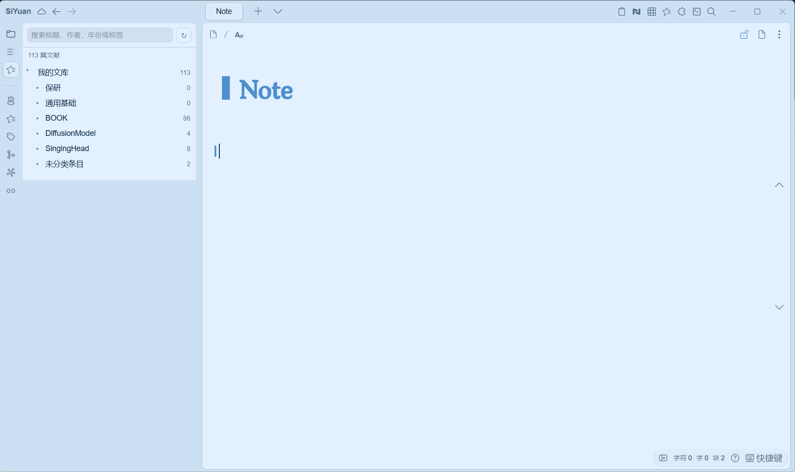

# Zotero 笔记（SiYuan 插件）

[English](README.md)

在思源笔记桌面端浏览 Zotero 10+ 文库，保留分类层级，按需创建论文文档与 `Note` 子文档，并将撰写内容回传到对应的 Zotero 条目。

> **当前处于内部测试阶段**
>
> 使用前请备份思源工作空间和 Zotero 数据，不要让插件中的内容成为重要笔记的唯一副本，并优先在非正式工作空间中测试。欢迎通过 [GitHub Issues](https://github.com/bnoij/siyuan-plugin-zotero-notes/issues) 提交问题、复现步骤和功能建议。

## 功能

- 自动导入个人文库的全部文献、嵌套分类和附件索引。
- 在思源 Dock 侧边栏中保留 Zotero 目录结构。
- 支持按标题、作者、年份和标签搜索。
- 按需创建文档，首次导入不会批量改写笔记本。
- 创建插件维护的论文页和用户自由撰写的 `Note` 子文档。
- 生成基本信息、摘要、标签和本地/Zotero 附件链接。
- 刷新论文元数据时不会修改 `Note`。
- 将 `Note` 导出为标准 Markdown，再转换为安全、可编辑的 Zotero 富文本笔记。
- 回写前以渲染效果预览，并逐项提示上传后可能丢失的格式；重复回写更新同一篇 Zotero 子笔记，并通过版本前提避免覆盖冲突编辑。
- 可设置文献列表中显示的作者数量，超出部分以“等”省略，避免长作者列表溢出。
- 可分别设置文库自动同步间隔和 Note 自动回传间隔（分钟，0 为关闭），Note 自动回传仅上传内容有变化的笔记。
- 文库刷新默认增量同步：先比对 Zotero 本地版本号，只拉取有变化的条目并识别删除；也可在设置中切换为全量同步。
- 论文文档带有 `custom-zotero-*` 属性标记，绑定关系与自动迁移基于思源数据库中的标记完成。
- 修改笔记本或根文档名称后，已有论文笔记自动迁移到新的根文档下，同名文档自动追加 itemKey 后缀。
- Dock 面板与按钮样式使用思源主题变量，自动适配明暗与第三方主题。

## 前置条件

- 思源笔记 3.7.0 或更高版本，Windows / macOS / Linux 桌面端。
- Zotero 10 或更高版本。
- 导入和回写时，Zotero 必须正在运行。
- 在 Zotero 的“设置 → 高级”中开启“允许此计算机上的其他应用与 Zotero 通信”。

目前不支持 Zotero 7、群组文库、移动端和 Zotero 云端 Web API，也不需要安装 Better BibTeX 或 debug-bridge。

## 安装

### 手动安装

1. 从本仓库的 [Releases](https://github.com/bnoij/siyuan-plugin-zotero-notes/releases) 下载 `package.zip`。
2. 解压到思源工作空间的 `data/plugins/siyuan-plugin-zotero-notes/`。
3. 重启思源，在“设置 → 集市 → 已下载”中启用“Zotero 笔记”。

插件目前尚未上架思源集市，完成测试和发布流程后再提供集市安装方式。

## 使用

1. 打开插件设置，选择笔记存放笔记本。
2. 保持根文档名称为默认的 `Zotero`，或按需修改（已有笔记会自动迁移到新根文档下）。
3. 打开“Zotero 笔记”Dock 并刷新文库。此操作只导入侧边栏索引，不创建文档。
4. 在文献条目上点击“新建笔记”，插件会创建：
   - `Zotero/论文题名`：插件维护的元数据页；
   - `Zotero/论文题名/Note`：用户自由撰写的笔记。
5. 在 `Note` 中撰写内容，点击该文献下方一排按钮中的“回传 Note”，检查 Markdown 预览并确认；也可以在设置中开启 Note 自动回传，插件会按间隔自动上传内容有变化的笔记。
6. 首次回写时，在 Zotero 弹窗中允许插件写入。选择“Always Allow”可让 Zotero 记住本次本地授权。

每篇文献下方都有同一行四个带框按钮：“新建/打开笔记”“刷新元数据”“回传 Note”“在 Zotero 中选中”。未创建笔记时，后两个按钮不可用；也可以点击文献标题直接打开已建文档。点击顶栏右侧的插件图标可打开设置页。

## 同步与转换规则

同步方向为 **思源 `Note` → Zotero 条目子笔记**，不是实时双向同步。

思源内核先导出标准 Markdown，再使用 Lute 转成 HTML；不会把 Kramdown 块属性或 `.sy` JSON 写入 Zotero。标题、列表、引用、代码、表格和链接由思源转换器处理。写入前会移除脚本、iframe、事件属性和危险 URL。

本地 PNG、JPEG、GIF、WebP 图片会内嵌到 Zotero 笔记。单张图片最大 5 MiB，单次回传图片总量最大 20 MiB；缺失或超限图片会被移除并在预览中警告。

Zotero 原生笔记是富文本 HTML；预览中的 Markdown 是交换格式，不代表 Zotero 内部以纯文本 Markdown 保存。若 Zotero 笔记在回写前已被修改，插件会报告版本冲突，不会自动覆盖。Zotero 条目被删除后，插件不会删除已有思源文档。

个人内容请写在 `Note` 中，论文页由插件维护。题名中的路径保留字符会被替换；同名但不同的文献会追加 itemKey 后缀。

## 隐私与数据安全

文库读取和回写仅访问本机 `127.0.0.1:23119`。设置、文库缓存、文档绑定和用户选择长期保留的 Zotero 本地写入密钥保存在思源插件私有存储中，不包含在发布包内，也不会写入日志。卸载插件不会删除论文文档或 Zotero 条目。

即使已有上述保护，内部测试期间仍请保持独立备份。

## 开发

本项目直接交付可加载的 CommonJS `index.js`，无 npm 依赖、无需构建。运行文件位于仓库根目录。

发布包根层包含 `plugin.json`、`index.js`、`index.css`、`i18n/`、中英文 README、`icon.png`、`preview.png` 和 `LICENSE`。

### 自动化检查

使用 Node.js 22 或更高版本运行 `npm test` 检查生命周期与多窗口回归场景，或运行 `npm run check` 同时检查语法和测试。覆盖启动写入、无变化缓存、`onDataChanged`、后台导入、跨窗口绑定合并和源站级文档创建锁。开发测试文件不会打入 `package.zip`。

## 反馈

请通过 [GitHub Issues](https://github.com/bnoij/siyuan-plugin-zotero-notes/issues) 提交问题和建议，并附上思源与 Zotero 版本、复现步骤、预期结果和实际结果。请勿提交私人文库数据、API Key 或授权令牌。

## 参考资料

- [Zotero Local API](https://www.zotero.org/support/dev/web_api/v3/local_api)
- [SiYuan API](https://github.com/siyuan-note/siyuan/blob/master/API.md)
- [SiYuan Plugin Sample](https://github.com/siyuan-note/plugin-sample)

## 许可证

本项目采用 [GNU Affero General Public License v3.0](LICENSE) 发布。
